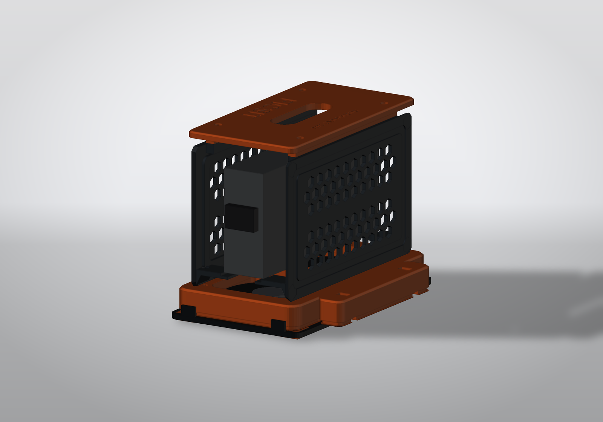
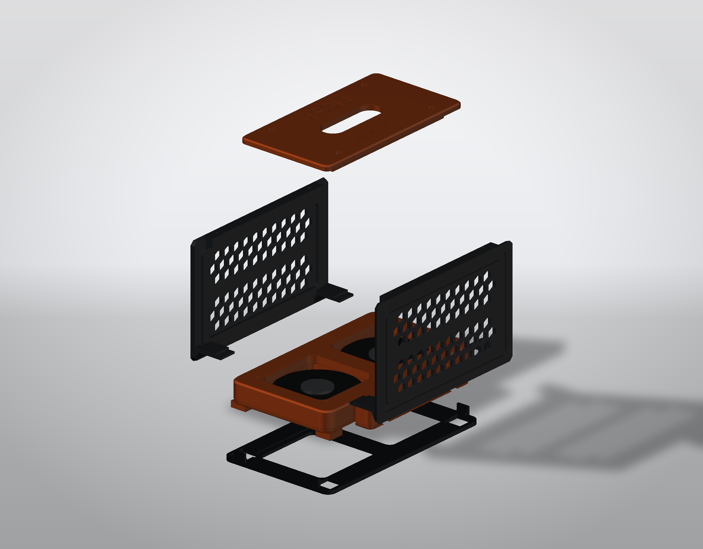

# FICSIT PSU Cooling Tower

**Охлаждающая башня для блока питания ноутбука 165 × 82 × 35 мм**
Параметрическая 3D-модель для FDM-печати. Стилистика — «производственный узел» из Satisfactory (fan-art, не связан с Coffee Stain Studios).



---

## 1. Что это и зачем

Блок питания ноутбука (165 × 82 × 35) годами лежит на столе и греется: у него нет собственного вентилятора, а пластиковый корпус отдаёт тепло только излучением и одной широкой гранью, которая прижата к столу. Решение — поставить его **на ребро**, освободив обе широкие грани, и продуть снизу двумя 80-мм вентиляторами, которые у вас уже есть (USB-питание), а поток выпустить вверх через перфорированные стенки — обычная «дымовая труба», только холодная.

Ключевая идея конструкции: **блок висит в воздухе**, опираясь на два кронштейна-«седла», а не лежит на дне. Воздух от кулеров бьёт прямо в его нижнюю грань, растекается в стороны и уходит вверх по обоим широким граням — то есть омывается вся поверхность, а не одна.

```
        ┌──────────────────┐  ← съёмная крышка с ручкой-проёмом
        │  ░░░ блок ░░░    │
        │  ░ 82 мм   ░     │  ← перфорированные стенки (соты),
   ┌────┤  ░         ░     ├────┐   поток выходит через них
   │    │  ░         ░     │    │
   │    │                  │    │
   │  ┌─┴──────────────────┴─┐  │
   │  │   ВОЗДУХ ↑ ↑ ↑ ↑ ↑   │  │  ← цоколь: 2 × 80-мм кулера
   │  │  ▓▓▓▓▓▓  ▓▓▓▓▓▓▓▓▓   │  │     утоплены снизу
   └──┤      фильтр-лоток     ├──┘
      └──────────────────────┘  ← резиновые ножки
```

---

## 2. Габариты и характеристики

| Параметр | Значение |
|---|---|
| Габарит собранного изделия | **190 × 131,6 × 148 мм** (Ш × Г × В) |
| Масса (ABS, по расчёту слайсера) | **≈ 230 г** |
| Масса (PLA) | ≈ 272 г |
| Кулеры | 2 × 80 × 80 × 10 мм, 71,5 мм межцентровое, USB |
| Посадочное место БП | 165 × 35, низ на высоте 40 мм, паз-фиксатор 36,4 × 2 мм |
| Площадь выхода воздуха | 2 × 66 шестигранных отверстий (9 мм под ключ) + проём 70 × 22 в крышке |
| Крепёж | 8 × M4 (кулеры), 8 × M3 (стенки + крышка), термовставки |
| Печать | без поддержек, все детали влезают в 220 × 220 × 250 |

### Детали

| Файл | Габарит печати, мм | Объём | Ориентация |
|---|---|---|---|
| `stl/01_base.stl` | 190,0 × 131,6 × 26,0 | 227 см³ | **вверх дном** (дека на столе) |
| `stl/02_wall_front.stl` | 176,0 × 110,0 × 31,2 | 63 см³ | **наружной стороной вниз** |
| `stl/03_wall_rear.stl` | 176,0 × 110,0 × 31,2 | 63 см³ | **наружной стороной вниз** |
| `stl/04_roof.stl` | 176,0 × 96,0 × 12,0 | 90 см³ | **верхней плоскостью вниз** |
| `stl/05_filter_tray.stl` | 196,2 × 116,0 × 12,0 | 44 см³ | как есть |

Все меши проверены: watertight, без вырожденных треугольников (`stl/print_check.json`).

---

## 3. Комплектующие (BOM)

| Поз. | Наименование | Кол-во | Примечание |
|---|---|---|---|
| 1 | Кулер 80 × 80 × 10, USB | 2 | ваши, с Ozon |
| 2 | Вставка резьбовая M4 (OD 5,5–6, L 6) | 8 | в цоколь, под кулеры |
| 3 | Винт M4 × 16–20, полукруглая головка | 8 | снизу, через кулер |
| 4 | Вставка резьбовая M3 (OD 4,5, L 5–6) | 8 | 4 в цоколь, 4 в верхние рейки стенок |
| 5 | Винт M3 × 20, потай | 4 | стенки к цоколю |
| 6 | Винт M3 × 18–20, потай | 4 | крышка к стенкам |
| 7 | Ножка силиконовая Ø10 × 2 | 4 | в потайные гнёзда снизу |
| 8 | Поролон/фильтр-ткань 80 × 80 × 2 | 2 | в лоток, под каждый кулер |
| 9 | Стяжки 2,5 мм | 2–3 | каналы для USB-проводов |

Всё остальное — печать.

---

## 4. Печать

**Материал:** ABS (рекомендую — деталь стоит рядом с греющимся БП и на столе, ABS не «плывёт»), PETG-CF тоже подходит. PLA — только если БП холодный: температура корпуса БП легко доходит до 50–60 °C, а PLA начинает ползти уже при 55 °C под нагрузкой.

**Настройки:**

- слой 0,2 мм (0,16 для стенок — красивее соты);
- периметры 3, верх/низ 4–5;
- заполнение 15–20 %, gyroid;
- **поддержки: НЕТ** ни для одной детали;
- брим 5 мм для цоколя и стенок (ABS любит отрываться на длинных деталях);
- камера закрыта, стол 100–110 °C (ABS), обдув 0–20 %.

**Ориентации (важно):**

1. **Цоколь** — перевернуть «вверх дном», декой на стол. Тогда все карманы кулеров смотрят вверх, ничего не свисает, а первым слоем идёт большая плоскость деки — 134 см² контакта.
2. **Стенки** — положить **наружной** стороной на стол. Все крепёжные и несущие элементы (кронштейны, рейка, рёбра) растут вверх, соты — вертикальные отверстия.
3. **Крышка** — верхней плоскостью вниз: гравировка «FICSIT» получается на первом слое и читается после печати.
4. **Фильтр-лоток** — плоско, клипсы вверх.

Расчётные нависания: цоколь 21 см², стенки 28 см², крышка 11 см² — это фаски 45° и кромки сот, они печатаются сами.

---

## 5. Сборка

1. **Термовставки.** В цоколь: 8 × M4 — в «уши» над карманами кулеров, вставлять **снизу**, паяльником при 240 °C; 4 × M3 — в площадки под кронштейны стенок, сверху. В верхние рейки обеих стенок: по 2 × M3, сверху.
2. **Кулеры.** Уложить в карманы снизу, провод — в боковой паз. Прикрутить M4 × 16–20 снизу; кулер подтягивается к потолку кармана, лопасти оказываются в 7,4 мм под плоскостью деки.
3. **Фильтр.** Вырезать 2 квадрата 80 × 80 из поролона, уложить в сёдла лотка, защёлкнуть лоток на нижнюю кромку цоколя (4 клипсы, снимается без инструмента).
4. **Стенки.** Поставить на деку, кронштейны ложатся на площадки, прикрутить M3 × 20 сверху вниз (4 винта).
5. **БП.** Снять крышку (4 × M3), завести блок с торца, опустить в паз-сёдла кронштейнов. Кабели (220 В и DC) выходят в открытые торцы — ничего не пережимается.
6. **Крышка.** Поставить на рейки, 4 × M3 × 18–20.
7. **Провода.** Оба USB-провода кулеров идут по каналам в дне к заднему «причалу» (площадка 130 × 22 с двумя канавками под стяжки) — там же удобно положить USB-разветвитель.



---

## 6. Как это работает (теплотехника)

- **Два 80-мм кулера** дают 20–35 CFM суммарно — для пассивного БП мощностью 90–180 Вт этого с запасом: ему нужен обдув, а не турбулентность.
- **Нижний вдув через фильтр** — пыль оседает на поролоне, а не на радиаторе БП и не на лопастях.
- **Боковые окна в цоколе** (7 сот на каждый торец) добавляют площади вдува, если фильтр забился.
- **Свободный подвес** блока: 22,5 мм зазора до каждой стенки — поток не «запирается», а идёт вдоль обеих широких граней.
- **Соты в стенках** — 66 отверстий Ø9 на каждую: суммарно ~0,07 м² выхода, сопротивление близко к нулю, скорость в щелях падает → тише.
- **Крышка с проёмом** работает как эжектор: горячий воздух уходит вверх, а не в лицо.

Ориентир: если ваш БП на 120 Вт грелся до 55 °C в покое, с продувом он выйдет на 35–40 °C.

---

## 7. Что внутри проекта

```
psu_cooler_ficsit/
├─ stl/                  ← готовые STL (печать) + manifest.json + print_check.json
├─ renders/              ← превью (PNG) и STL в координатах сборки
├─ src/
│  ├─ model.py           ← вся геометрия, параметры в словаре P
│  ├─ geom.py            ← мини-CAD: примитивы, призмы, текст, фаски (manifold3d + shapely)
│  ├─ export_stl.py      ← сборка + ориентация под печать + экспорт
│  ├─ check_print.py     ← аудит печати: габариты, массы, нависания, контакт со столом
│  └─ render.py          ← софтверный рендер (z-buffer + рёбра) для превью
└─ docs/
   ├─ THINGIVERSE.md     ← готовое описание для публикации (EN)
   └─ REPO.md            ← как вести репозиторий, теги, лицензия
```

Модель **параметрическая**: все размеры (БП, кулеры, толщины, зазоры, узор сот, надписи) — в словаре `P` в `src/model.py`. Поменяли БП на 170 × 85 × 40 — правите 4 числа и пересобираете.

### Пересборка

```powershell
cd src
python -m pip install -r requirements.txt
python model.py        # проверка объёмов и габаритов
python export_stl.py   # stl/*.stl + manifest
python check_print.py  # отчёт по печати
python render.py       # картинки
```

Зависимости: `manifold3d`, `shapely`, `trimesh`, `numpy`, `Pillow`, `matplotlib` (для шрифтовых контуров) — все перечислены в `src/requirements.txt`. Python 3.10+.

---

## 8. Проверка в КОМПАС-3D

STL — стандартный бинарный, импортируется в КОМПАС-3D (Файл → Открыть → STL, либо «Импорт меша»), удобно для проверки посадок и построения сборочного чертежа. Исходная геометрия — точная (булевы операции на manifold3d), поэтому пересборка из `src/` даёт ту же модель в любой момент.

---

## 9. Лицензия и правовая оговорка

- Модель: **CC BY-NC-SA 4.0** — можно печатать, изменять, публиковать с указанием автора, без коммерческого использования.
- Стилистика и название **FICSIT / Satisfactory** — интеллектуальная собственность Coffee Stain Studios. Это фанатская работа «в стиле», не аффилированная с правообладателем. Для коммерческой продажи печати уберите надписи FICSIT и публикуйте как «Industrial Cooling Tower».
- Логотип набран шрифтом Arial Bold (метрически совместимый заменитель), контуры переведены в геометрию — в файлах нет встроенных шрифтов.

---

## 10. Идеи развития

- **Подсветка:** под крышкой вдоль стенок есть свободные 12 мм — можно прорезать канал 6 × 3 мм под ленту 5 В и вывести провод по задней рейке; ваши диоды как раз туда.
- **Второй ярус:** стойка под ещё один БП — цоколь уже имеет посадочные площадки.
- **Регулятор оборотов:** место в заднем «причале» под миниатюрный DC-DC или резистор.
- **Фильтр из нетканого полотна** вместо поролона — меньшее сопротивление, лучше очистка.
- **Датчик температуры:** сплошная полоса стенки над сотами (20 мм) удобна под карман для миниатюрного LCD-термометра.
