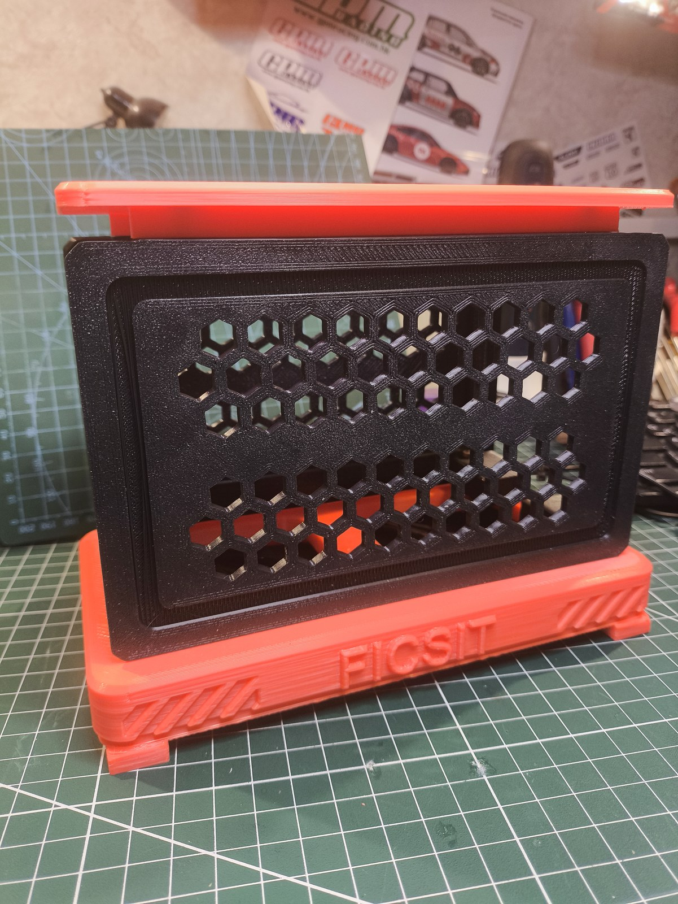
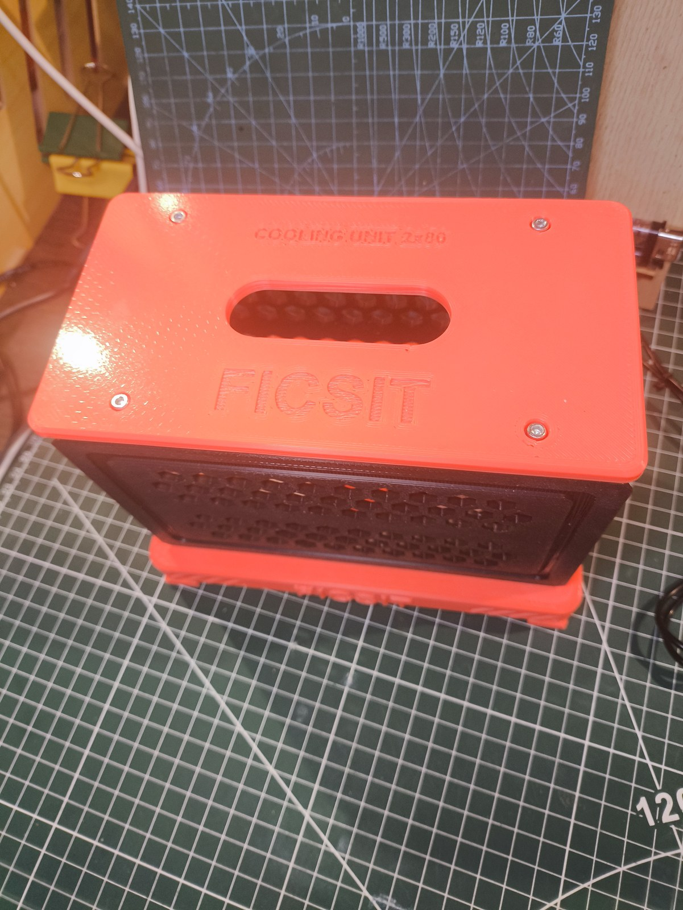
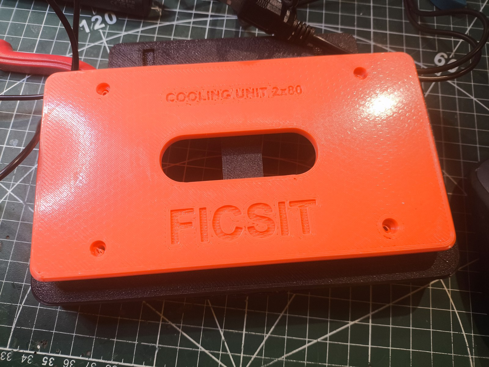
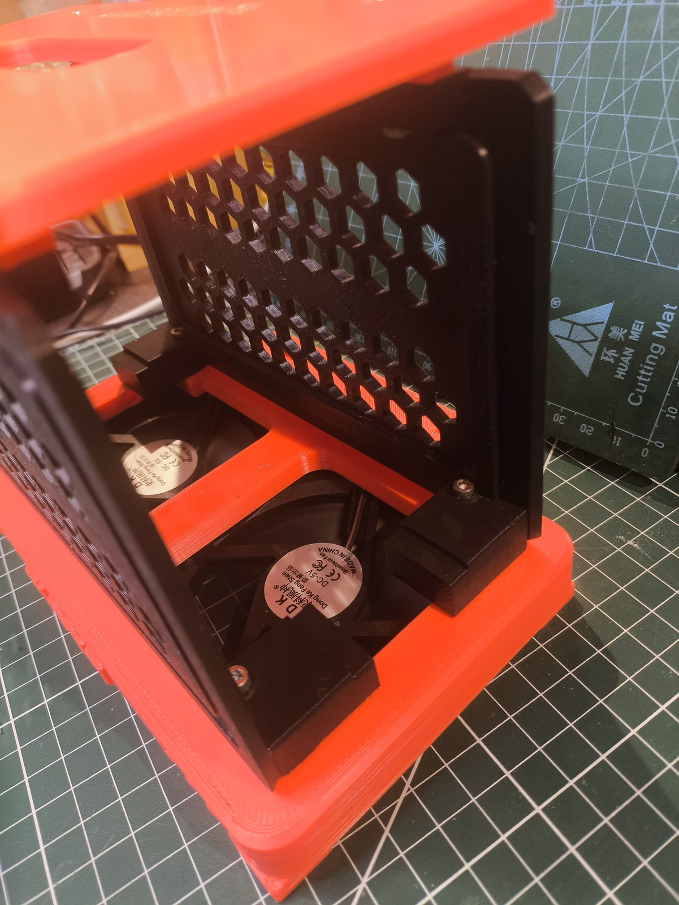
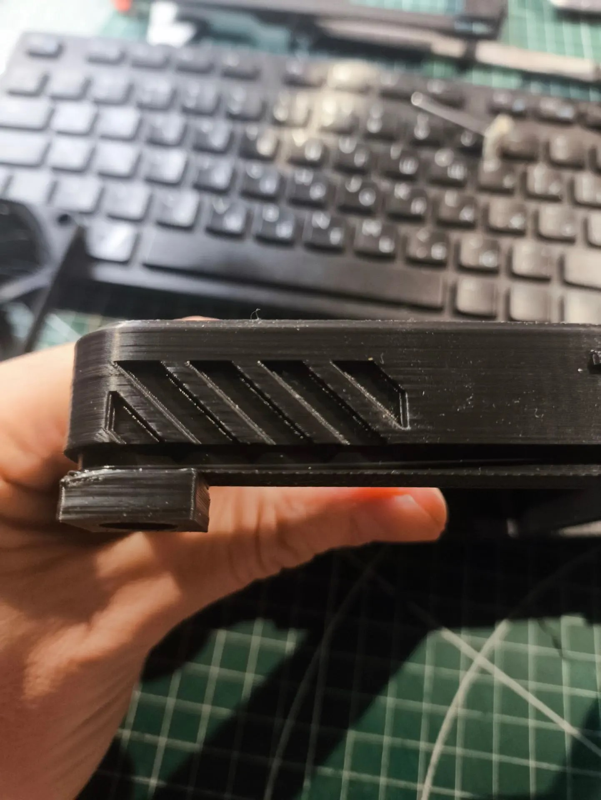
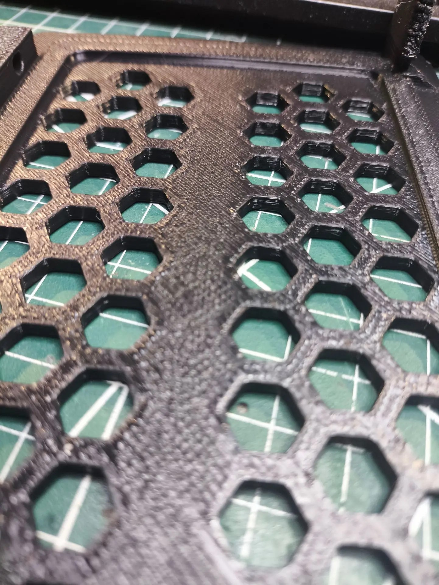

# FICSIT PSU Cooling Tower

**Охлаждающая башня для блока питания ноутбука 165 × 82 × 35 мм**
Параметрическая 3D-модель для FDM-печати. Стилистика — «производственный узел» из Satisfactory (fan-art, не связан с Coffee Stain Studios).


**Напечатано и собрано** — v1.2, ABS (красный цоколь/крышка/лоток, чёрные стенки), два 80-мм кулера внутри:

<table>
  <tr>
    <td width="50%"></td>
    <td width="50%"></td>
  </tr>
  <tr>
    <td></td>
    <td></td>
  </tr>
</table>

Остальные фото (цоколь снизу, термовставки) — в `photos/`.

---

## 1. Что это и зачем

Блок питания ноутбука (165 × 82 × 35) годами лежит на столе и греется: у него нет собственного вентилятора, а пластиковый корпус отдаёт тепло только излучением и одной широкой гранью, которая прижата к столу. Решение — поставить его **на ребро**, освободив обе широкие грани, и продуть снизу двумя 80-мм вентиляторами, которые у вас уже есть (USB-питание), а поток выпустить вверх через перфорированные стенки — обычная «дымовая труба», только холодная.

Ключевая идея конструкции: **блок висит в воздухе**, опираясь на два кронштейна-«седла», а не лежит на дне. Воздух от кулеров бьёт прямо в его нижнюю грань, растекается в стороны и уходит вверх по обоим широким граням — то есть омывается вся поверхность, а не одна.

```
        ┌──────────────────┐  ← съёмная крышка с ручкой-проёмом
        │  ░░░ блок ░░░    │
        │  ░ 82 мм   ░     │  ← перфорированные стенки (соты),
   ┌────┤  ░         ░     ├────┐   поток выходит через них
   │    │  ░         ░     │    │
   │    │                  │    │
   │  ┌─┴──────────────────┴─┐  │
   │  │   ВОЗДУХ ↑ ↑ ↑ ↑ ↑   │  │  ← цоколь: 2 × 80-мм кулера
   │  │  ▓▓▓▓▓▓  ▓▓▓▓▓▓▓▓▓   │  │     утоплены снизу
   └──┤      фильтр-лоток     ├──┘
      └──────────────────────┘  ← резиновые ножки
```

---

## 2. Габариты и характеристики

| Параметр | Значение |
|---|---|
| Габарит собранного изделия | **190 × 131,6 × 148 мм** (Ш × Г × В) |
| Масса (ABS, по расчёту Orca) | **≈ 359 г** на все пять деталей |
| Масса (PLA, пересчёт по плотности) | ≈ 428 г |
| Время печати (ABS, Orca) | ≈ 11 ч 30 м |
| Кулеры | 2 × 80 × 80 × **11** мм (карман 82,4 × 12,6 — влезает до 12 мм), 71,5 мм межцентровое, USB |
| Посадочное место БП | 165 × 35, низ на высоте 40 мм, паз-фиксатор 36,4 × 2 мм |
| Площадь выхода воздуха | 2 × 66 шестигранных отверстий (9 мм под ключ) + проём 70 × 22 в крышке |
| Крепёж | 8 × M4 (кулеры), 8 × M3 (стенки + крышка), термовставки |
| Печать | без поддержек, все детали влезают в 220 × 220 × 250 |

### Детали

| Файл | Габарит печати, мм | Объём | Ориентация |
|---|---|---|---|
| `stl/01_base.stl` | 190,0 × 131,6 × 26,0 | 216 см³ | **вверх дном**, поворот вокруг длинной оси |
| `stl/02_wall_front.stl` | 176,0 × 110,0 × 31,2 | 77 см³ | **наружной стороной вниз** |
| `stl/03_wall_rear.stl` | 176,0 × 110,0 × 31,2 | 77 см³ | **наружной стороной вниз** |
| `stl/04_roof.stl` | 176,0 × 96,0 × 12,0 | 90 см³ | **верхней плоскостью вниз**, поворот вокруг длинной оси |
| `stl/05_filter_tray.stl` | 196,2 × 116,0 × 12,0 | 44 см³ | как есть |

Все меши проверены: watertight, без вырожденных треугольников (`stl/print_check.json`).

---

## 3. Комплектующие (BOM)

| Поз. | Наименование | Кол-во | Примечание |
|---|---|---|---|
| 1 | Кулер 80 × 80 × 11, USB | 2 | ваши, с Ozon |
| 2 | Вставка резьбовая M4 (OD 5,5–6, L 6) | 8 | в цоколь, под кулеры |
| 3 | Винт M4 × 18 (подойдёт × 16), полукруглая головка | 8 | снизу, через кулер: 12,5 мм до гнезда + 6 мм резьбы, × 20 уже упирается в дно гнезда |
| 4 | Вставка резьбовая M3 (OD 4,0, L 5–6) | 8 | 4 в цоколь, 4 в верхние рейки стенок. Гнездо в модели Ø4,0 → на детали ~Ø3,6 |
| 5 | Винт M3 × 20, потай | 4 | стенки к цоколю |
| 6 | Винт M3 × 18–20, потай | 4 | крышка к стенкам |
| 7 | Ножка силиконовая Ø10 × 2 | 4 | в потайные гнёзда снизу |
| 8 | Поролон/фильтр-ткань 80 × 80 × 2 | 2 | в лоток, под каждый кулер |
| 9 | Стяжки 2,5 мм | 2–3 | каналы для USB-проводов |

Всё остальное — печать.

---

## 4. Печать

**Материал:** ABS (рекомендую — деталь стоит рядом с греющимся БП и на столе, ABS не «плывёт»), PETG-CF тоже подходит. PLA — только если БП холодный: температура корпуса БП легко доходит до 50–60 °C, а PLA начинает ползти уже при 55 °C под нагрузкой.

**Настройки:**

- слой 0,2 мм (0,16 для стенок — красивее соты);
- периметры 3, верх/низ 4–5;
- заполнение 15–20 %, gyroid;
- **поддержки: НЕТ** ни для одной детали;
- брим 5 мм для цоколя и стенок (ABS любит отрываться на длинных деталях);
- камера закрыта, стол 100–110 °C (ABS), обдув 0–20 %.

**Ориентации (важно):**

1. **Цоколь** — перевернуть «вверх дном», декой на стол, поворотом **вокруг длинной оси**. Тогда все карманы кулеров смотрят вверх, ничего не свисает, а первым слоем идёт большая плоскость деки — 137 см² контакта. (Поворот вокруг короткой оси даст зеркало: логотип напечатается наоборот.)
2. **Стенки** — положить **наружной** стороной на стол. Все крепёжные и несущие элементы (кронштейны, рейка, рёбра) растут вверх, соты — вертикальные отверстия.
3. **Крышка** — верхней плоскостью вниз, тоже вдоль длинной оси: гравировка «FICSIT» получается на первом слое и читается после печати.
4. **Фильтр-лоток** — плоско, клипсы вверх.

Расчётные нависания: цоколь 24 см², стенки 29 см², крышка 11 см², лоток 0,9 см² — это фаски 45° и кромки сот, они печатаются сами.

---

## 5. Сборка

1. **Термовставки.** В цоколь: 8 × M4 — в «уши» над карманами кулеров, вставлять **снизу**, паяльником при 240 °C; 4 × M3 — в площадки под кронштейны стенок, сверху. В верхние рейки обеих стенок: по 2 × M3, сверху.
2. **Кулеры.** Уложить в карманы снизу, провод — в жёлоб по стороне кармана и дальше в канал x = ±44. Прикрутить **M4 × 18** снизу (× 16 тоже держит: 3,5 мм резьбы); кулер 11 мм подтягивается к гнезду, над лопастями остаётся 1,6 мм.
3. **Фильтр.** Вырезать 2 квадрата 80 × 80 из поролона, уложить в сёдла лотка, защёлкнуть лоток на нижнюю кромку цоколя (4 клипсы, снимается без инструмента).
4. **Стенки.** Поставить на деку, кронштейны ложатся на площадки, прикрутить M3 × 20 сверху вниз (4 винта).
5. **БП.** Снять крышку (4 × M3), завести блок с торца, опустить в паз-сёдла кронштейнов. Кабели (220 В и DC) выходят в открытые торцы — ничего не пережимается.
6. **Крышка.** Поставить на рейки, 4 × M3 × 18–20.
7. **Провода.** Оба USB-провода кулеров идут по каналам в дне к заднему «причалу» (площадка 130 × 22 с двумя канавками под стяжки) — там же удобно положить USB-разветвитель.


---

## 6. Как это работает (теплотехника)

- **Два 80-мм кулера** дают 20–35 CFM суммарно — для пассивного БП мощностью 90–180 Вт этого с запасом: ему нужен обдув, а не турбулентность.
- **Нижний вдув через фильтр** — пыль оседает на поролоне, а не на радиаторе БП и не на лопастях.
- **Боковые окна в цоколе** (7 сот на каждый торец) добавляют площади вдува, если фильтр забился.
- **Свободный подвес** блока: 22,5 мм зазора до каждой стенки — поток не «запирается», а идёт вдоль обеих широких граней.
- **Соты в стенках** — 66 отверстий Ø9 на каждую: суммарно ~0,07 м² выхода, сопротивление близко к нулю, скорость в щелях падает → тише.
- **Крышка с проёмом** работает как эжектор: горячий воздух уходит вверх, а не в лицо.

Ориентир: если ваш БП на 120 Вт грелся до 55 °C в покое, с продувом он выйдет на 35–40 °C.

---

## 7. Что внутри проекта

```
psu_cooler_ficsit/
├─ stl/                  ← готовые STL (печать) + manifest.json + print_check.json
├─ renders/              ← превью (PNG) и STL в координатах сборки
├─ First_print/          ← фото первой печати; разбор — docs/REWORK_v2.md
├─ photos/               ← фото готового собранного изделия (v1.2)
├─ print/                ← пресеты ABS, проекты OrcaSlicer, отчёты слайсера
├─ src/
│  ├─ model.py           ← вся геометрия, параметры в словаре P
│  ├─ geom.py            ← мини-CAD: примитивы, призмы, текст, фаски (manifold3d + shapely)
│  ├─ export_stl.py      ← сборка + ориентация под печать + экспорт
│  ├─ check_print.py     ← аудит печати: габариты, массы, нависания, контакт со столом
│  ├─ check_holes.py     ← автодопуск: отверстия не слиплись, стенки вокруг них достаточны
│  ├─ section_view.py    ← горизонтальные срезы деталей + контурные метрики
│  └─ render.py          ← софтверный рендер (z-buffer + рёбра) для превью
└─ docs/
   ├─ THINGIVERSE.md     ← готовое описание для публикации (EN)
   ├─ PRINTABLES.md      ← текст под printables.com (EN, plain text для вставки)
   ├─ CHANGELOG.md       ← история версий с массами и временем
   ├─ REWORK_v2.md      ← разбор первой печати → план правок
   └─ REPO.md            ← как вести репозиторий, теги, лицензия
```

Модель **параметрическая**: все размеры (БП, кулеры, толщины, зазоры, узор сот, надписи) — в словаре `P` в `src/model.py`. Поменяли БП на 170 × 85 × 40 — правите 4 числа и пересобираете.

### Пересборка

```powershell
cd src
python -m pip install -r requirements.txt
python model.py        # проверка объёмов и габаритов
python export_stl.py   # stl/*.stl + manifest
python check_print.py  # отчёт по печати
python render.py       # картинки
```

Зависимости: `manifold3d`, `shapely`, `trimesh`, `numpy`, `Pillow`, `matplotlib` (для шрифтовых контуров) — все перечислены в `src/requirements.txt`. Python 3.10+.

---

## 8. Проверка в КОМПАС-3D

STL — стандартный бинарный, импортируется в КОМПАС-3D (Файл → Открыть → STL, либо «Импорт меша»), удобно для проверки посадок и построения сборочного чертежа. Исходная геометрия — точная (булевы операции на manifold3d), поэтому пересборка из `src/` даёт ту же модель в любой момент.

---

## 9. Лицензия и правовая оговорка

- Модель: **CC BY-NC-SA 4.0** — можно печатать, изменять, публиковать с указанием автора, без коммерческого использования.
- Стилистика и название **FICSIT / Satisfactory** — интеллектуальная собственность Coffee Stain Studios. Это фанатская работа «в стиле», не аффилированная с правообладателем. Для коммерческой продажи печати уберите надписи FICSIT и публикуйте как «Industrial Cooling Tower».
- Логотип набран шрифтом Arial Bold (метрически совместимый заменитель), контуры переведены в геометрию — в файлах нет встроенных шрифтов.

---

## 10. Идеи развития

- **Подсветка:** под крышкой вдоль стенок есть свободные 12 мм — можно прорезать канал 6 × 3 мм под ленту 5 В и вывести провод по задней рейке; ваши диоды как раз туда.
- **Второй ярус:** стойка под ещё один БП — цоколь уже имеет посадочные площадки.
- **Регулятор оборотов:** место в заднем «причале» под миниатюрный DC-DC или резистор.
- **Фильтр из нетканого полотна** вместо поролона — меньшее сопротивление, лучше очистка.
- **Датчик температуры:** сплошная полоса стенки над сотами (20 мм) удобна под карман для миниатюрного LCD-термометра.

---

## 11. Первая печать: что показала практика

Напечатаны и собраны все пять деталей (ABS, профиль `DSH_JAMG-HE ABS`): фото готового изделия — в `photos/`, фото первой печати с замечаниями — в `First_print/`, разбор — в `docs/REWORK_v2.md`.

<p>
  
  
</p>

Что исправлено в **v1.2**:

| Замечание по печати | Что сделано в модели |
|---|---|
| Логотип «FICSIT» печатался зеркально | В экспорте был `mirror()` (отражение) — заменено поворотом вокруг длинной оси. Переворачивать напечатанную деталь тоже вокруг длинной оси. |
| Провода кулеров некуда вывести | Жёлоб 7 × 4 мм по сторонам каждого кармана, выходит в каналы x = ±44 под лотком. |
| «Уши» кронштейнов задирало, отверстия не печатались | Вместо 4-мм полки на 28-мм ножке — сплошной башмак 22 × 28 мм от деки; отверстия M3/M4 «каплей» (45°), фаска 1,5 × 45°. |
| Недолив первого слоя, переэкструзия верхних слоёв | Профили: ширина первого слоя 0,72, слой 0,35, PA 0,045, ускорение внешней стенки 3000, `top_surface_flow` 0,95. |
| Два неглубоких прямоугольника на «причале» | Убраны, вместо них два сквозных паза 18 × 4 мм под стяжку. |

Итого по слайсеру: **≈ 359 г ABS**, ≈ 11 ч 30 м на все пять деталей, поддержек — 0 г.
